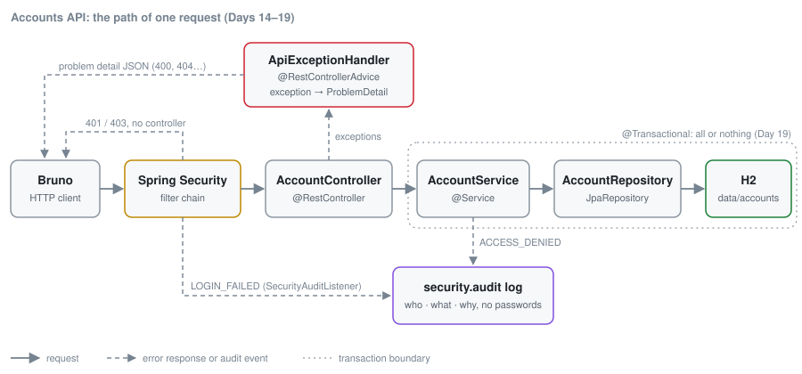

# The Accounts API at a glance

The modern Accounts API (Days 1–5 and 14–23; Java 25, Spring Boot 4.1.2), as it stands after Day 19. Every request goes left to right; errors and audit events take the dashed paths. Code: `day-19-all-or-nothing-transfers/solution/src/main/java/com/example/accounts/`. Days 20–23 keep the same shape and add to the boxes (a version column, an `IdempotencyRecord` table beside the repository, a `Money` type in the model, a `Mask` helper): see the table below.

- **Spring Security filter chain** (`config/SecurityConfig`): checks the login and the URL rules *before* any controller runs, so it answers [401 and 403](glossary.md#401-vs-403) itself.
- **`AccountController`** (`controller/`): HTTP in, [DTOs](glossary.md#dto) out. No business rules.
- **`ApiExceptionHandler`** (`exception/`): turns our exceptions and validation failures into [problem details](glossary.md#problem-detail).
- **`AccountService`** (`service/`): the rules: supported currencies, who may see which account, transfers.
- **`AccountRepository`** (`repository/`): Spring Data writes the queries; H2 stores them in `data/`.
- **`security.audit`**: a named logger for security events (`ACCESS_DENIED`, `LOGIN_FAILED`).

## Which day changes which box

<!-- course:diagram -->
| Day | Box | What changes | Why |
|---|---|---|---|
| [1](../day-01-complete-the-crud-api/) | `ApiExceptionHandler` | New: `@RestControllerAdvice` turns `AccountNotFoundException` and validation errors into problem details; `PUT` and `DELETE` arrive, with 404s | One error format for every endpoint |
| [14](../day-14-login-and-roles/) | Security filter chain | `SecurityConfig` with HTTP Basic, roles `CUSTOMER` / `TELLER`, deny by default | OWASP A01 Broken Access Control: roles |
| [15](../day-15-whose-account-is-it/) | `AccountService` | An `Account.username` owner column and an ownership check in `AccountService.getVisibleTo` (someone else's account is a 404) | OWASP A01: [IDOR](glossary.md#idor) |
| [16](../day-16-injection/) | `AccountRepository` | String-built JPQL in the service is replaced by a query method, `findByUsernameAndCurrency` | OWASP A05 [Injection](glossary.md#injection): bound parameters |
| [17](../day-17-storing-passwords/) | Security filter chain | A `PasswordEncoder` bean: `{noop}` plain-text passwords become salted `{pbkdf2}` hashes | OWASP A04 / A07: [hashing](glossary.md#hashing-vs-encryption) |
| [18](../day-18-audit-logs/) | `security.audit` log | `SecurityAuditListener` logs `LOGIN_FAILED`; `AccountService` logs `ACCESS_DENIED`; `AuditLog.clean` strips line breaks | OWASP A09: attacks you can see |
| [19](../day-19-all-or-nothing-transfers/) | `AccountService` | `POST /accounts/{id}/transfers`; `@Transactional` on `transfer`, with every check before any change | OWASP A10: [all or nothing](glossary.md#transaction), [fail closed](glossary.md#fail-closed) |
| [20](../day-20-two-transfers-at-once/) | `Account` entity, `ApiExceptionHandler` | A [`@Version`](glossary.md#version) field: a stale write fails at commit instead of overwriting; `OptimisticLockingFailureException` → 409 `Concurrent update` | [Optimistic locking](glossary.md#optimistic-locking): no lost updates |
| [21](../day-21-idempotent-payments/) | Controller, `AccountService`, new `IdempotencyRecord` table | An [`Idempotency-Key`](glossary.md#idempotency-key) header, stored in the same transaction as the transfer: a retry replays the answer, a reused key with a different body is 422 | Safe retries: never pay twice |
| [22](../day-22-money-done-right/) | Model (`Money`), DTOs | A `Money` record (amount + [currency](glossary.md#iso-4217)) that refuses mixed currencies and never rounds silently ([rounding mode](glossary.md#rounding-mode) `UNNECESSARY`); `@Digits` allows 2 decimal places | Correct amounts |
| [23](../day-23-mask-what-you-show/) | `AccountResponse`, the transfer log line | One `Mask.accountNumber` helper: `****5678` in every response and log line; the stored number is unchanged | Less [PII](glossary.md#pii) on show ([masking](glossary.md#masking)) |
| [26](../day-26-triage-a-scanner-report/) | `NotificationsClient`, `TokenHasher` and the scan paperwork | The notifications API key comes from configuration (`notifications.api-key`), not the code; API tokens are hashed with SHA-256, not MD5 | [SAST](glossary.md#sast) findings triaged: fix, [false positive](glossary.md#false-positive) or [accepted risk](glossary.md#accepted-risk) |
<!-- /course:diagram -->

Days 2–5 work on the same boxes without adding new ones (a code review, a refactor into DTOs and `SupportedCurrencies`, unit and slice tests). Days 6–13 are a different, 2022 codebase.

Related: [Glossary](glossary.md) · [Java idioms](java-idioms.md) · [Troubleshooting](troubleshooting.md) · [OWASP Top 10 cheat sheet](owasp-top-10-cheatsheet.md)
